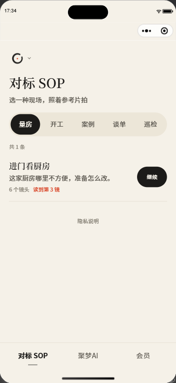
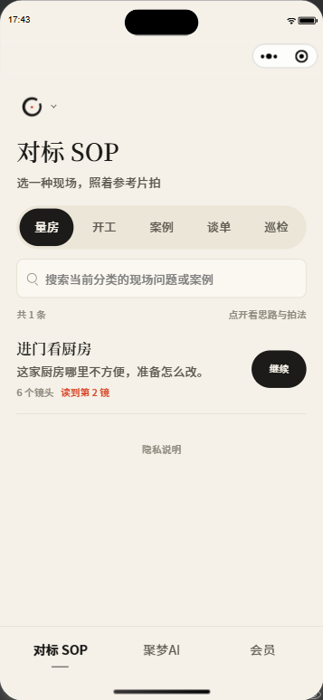
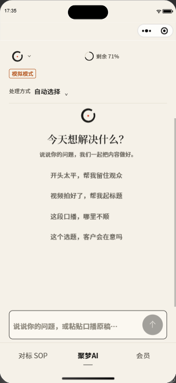
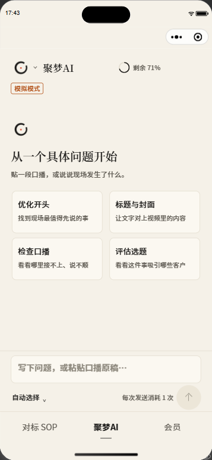
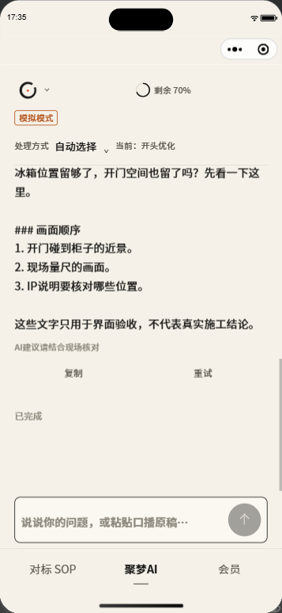
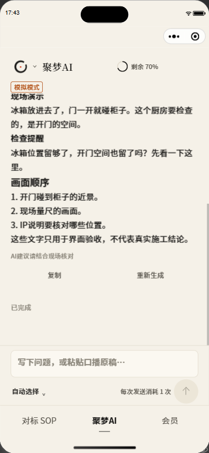
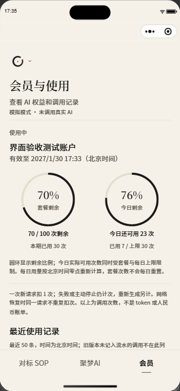
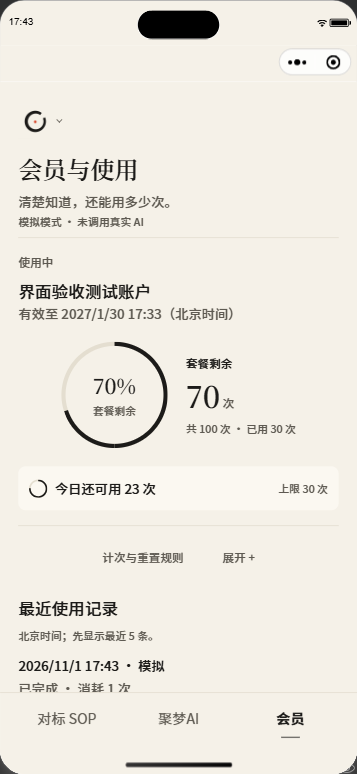

# 聚梦传媒小程序：10项界面问题与优化

检查基线：`bacf5a2`。检查与截图：2026-11-01；整理交付：2026-11-02。范围：原生SOP、聚梦AI、会员、品牌菜单与底部导航。保留现有品牌、配色、三项Tab、SOP默认页与服务端计次权限。本轮采用dbs确定范围，以redesign-existing-projects审计和修改既有原生界面；没有引入第三方前端框架或运行第三方dbskill内容。

## 问题与处理

| # | 原问题与影响 | 优化建议及实现 | 验证依据 |
|---|---|---|---|
| 1 | AI顶栏只有品牌Logo与额度，页面名称只能从底部导航确认 | 在Logo旁显示聚梦AI，保留原Logo菜单与小圆环入口 | AI空态截图 |
| 2 | 常用需求是四行同权重长句，选择后只填入文字、没有聚焦反馈 | 改为四项有名称和说明的两列入口，点击聚焦输入末尾；开始输入后收起建议 | AI空态截图、聚焦回归测试 |
| 3 | 处理方式与当前方法挤在顶栏，增加内容上方的固定占用 | 方法选择移到输入区工具行；实际使用的方法保留在回答旁，发送前明确一次扣1次 | AI空态/回答截图 |
| 4 | 每次流式更新都scrollToEnd，上滑读旧消息会被拉回 | 向上滚动暂停跟随，到底恢复；提供回到最新按钮。不依赖视口测量回调 | 原生滚动检查、回归测试 |
| 5 | 模型输出用纯text渲染，标题和加粗露出###与星号 | 用原生rich-text呈现轻量标题、加粗、行内代码和代码段；原文仍可复制，不执行模型HTML或图片 | 回答截图、格式和HTML边界测试 |
| 6 | 已完成回答下的重试实质创建新请求并扣次，名称易误解 | 改为重新生成，原生弹窗说明消耗1次，取消不发送；重生成沿用原回答的方法 | 原生弹窗截图、取消/确认回归测试 |
| 7 | 会员页双圆环和规则文字同权重，刷新时又回到登录按钮 | 主套餐圆环配明确的剩余次数，今日可用作为次级条；规则折叠、记录先显示5条；查询时显示骨架，不显示旧余额 | 会员截图、既有余额失败回归测试 |
| 8 | 案例超过20条才允许搜索，当前少量课程没有查找入口 | 有案例就显示分类内搜索，覆盖案例名/任务/视频思路；无结果提供清空和分类提醒 | SOP和搜索空态截图、少量案例搜索回归测试 |
| 9 | 详情切镜仅有数字进度，页面位置沿用上一镜；快速切镜时播放器延迟回调可能覆盖新选择 | 增加镜头进度线与最后一镜提示，切镜定位到标题；同步更新镜号并拒绝旧回调覆盖，保留暂停、续看和contain播放器 | 详情进度截图、快速切镜回归与原生检查 |
| 10 | 分类、菜单、底部导航和主要操作缺少一致触摸反馈 | 加入按压反馈、140/220ms动效、菜单展开和导航标记过渡，加载骨架使用扫光；减少动态效果设置下关闭循环/位移动效 | 原生状态截图、样式源码和官方编译 |

## 开源参考与采用范围

- [assistant-ui Thread](https://github.com/assistant-ui/assistant-ui/blob/main/apps/docs/content/docs/primitives/thread.mdx)：参考用户上滑后暂停自动滚动、回到底部入口和输入区避让思路。
- [assistant-ui Elements](https://www.assistant-ui.com/elements/thread)：参考建议入口、消息操作和内容呈现的分工。
- [Tencent TDesign小程序](https://github.com/Tencent/tdesign-miniprogram)、[Tabs动画属性](https://github.com/Tencent/tdesign-miniprogram/blob/develop/packages/components/tabs/type.ts)、[Skeleton](https://tdesign.tencent.com/miniprogram/components/skeleton-en)：参考短时状态过渡与结构相符的加载占位。
- [微信WeUI小程序](https://github.com/wechat-miniprogram/weui-miniprogram)：参考贴近微信原生的列表、操作入口和反馈方式。

上述项目作为交互参考；实现保留本项目WXML/WXSS/TypeScript，未拷贝库源码或新增运行依赖。

## 验收范围

36项Node测试全部通过，0失败、0跳过；官方WXML/WXSS编译通过，7项原生操作检查通过。截图来自微信开发者工具原生模拟器，使用独立SQLite测试账户和有标识的模拟回答，没有调用付费模型，没有修改真实学员权益。静态截图验证布局与状态，动效时序以实现和操作检查为依据，不将一张截图称为完整动画验收。

截图与原生操作检查记录见同目录的screenshots/2026-11-01-ui。模拟器验收不替代手机触控、键盘、安全区与真实微信身份联调。未部署生产服务、未上传原媒体、未提交微信审核。

## 运行截图

这些是原生小程序运行截图。截图里的权益为测试数据，前后数值变化不作为优化效果依据；未收录含原视频画面的详情截图。

| 页面 | 改前 | 改后 |
|---|---|---|
| SOP目录 |  |  |
| AI空态与输入区 |  |  |
| AI回答 |  |  |
| 会员用量 |  |  |

[镜头进度](screenshots/2026-11-01-ui/after/03-shot-progress.png)、[阅读旧消息](screenshots/2026-11-01-ui/after/08-read-previous.png)、[重新生成扣次提示](screenshots/2026-11-01-ui/after/09-regenerate-confirm.png)、[搜索无结果](screenshots/2026-11-01-ui/after/10-search-empty.png)。[7项原生检查及输入区尺寸记录](screenshots/2026-11-01-ui/verification.json)。
